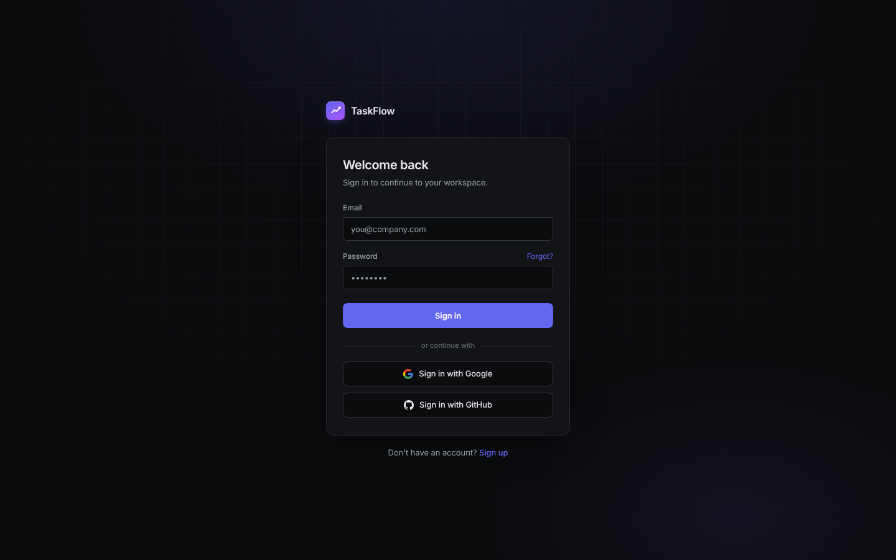

# TaskFlow — таск-менеджер

Командный таск-менеджер в духе Plane и Jira: рабочие пространства, проекты, задачи со списком и канбан-доской, участники и приглашения, уведомления, чат и AI-помощник. Фронтенд работает с REST API, дизайн перенесён из Plane — тёмная тема по умолчанию.

Командный проект: фронтенд делали вдвоём, задачи распределены в [`roadmaps/`](roadmaps).




## Возможности

- **Авторизация.** Регистрация и вход по JWT: access-токен в памяти, refresh-токен с ротацией, защищённые маршруты.
- **Рабочие пространства.** Создание и удаление, приглашение участников по ссылке, роли (owner, admin, member, guest).
- **Проекты.** Создание, удаление, участники проекта.
- **Задачи.** Создание, карточка задачи, комментарии, удаление. Два вида: список и канбан-доска с перетаскиванием задач между статусами, группировка.
- **Обзор.** «Моя работа», графики задач по статусам и приоритетам, загрузка участников, недавнее.
- **Входящие** — уведомления о назначениях, комментариях и упоминаниях.
- **AI-помощник.** Генерация описания задачи по подсказке и краткое саммари обсуждения.
- **Чат, Wiki, онбординг, профиль.**
- **Командная палитра** по `⌘K` / `Ctrl+K` для быстрой навигации.

## Как устроено

- **Единый axios-клиент** с интерсепторами: подставляет `Authorization: Bearer`, при `401` обновляет пару токенов и повторяет запрос. Параллельные запросы ждут одно общее обновление, без гонок.
- **Своя сессия у каждой вкладки.** Refresh-токен хранится в `sessionStorage`, а `localStorage` — запасной вариант для новой вкладки. Так вход в другой вкладке под другим аккаунтом не «перещёлкивает» текущую.
- **Серверные данные — в TanStack Query**, клиентское состояние (токены, выбранное пространство, UI) — в Zustand. Данные не дублируются.
- **Дизайн-токены Plane** (цвета в OKLCH, шрифты Inter и IBM Plex Mono) заведены CSS-переменными, компоненты используют семантические имена.
- **Ошибки API** обрабатываются по коду (`VALIDATION_ERROR`, `FORBIDDEN`, …), ошибки валидации попадают к нужным полям формы.

## Стек

React · TypeScript (strict) · Vite · Tailwind CSS · TanStack Query · Zustand · Axios · ESLint + Prettier

## Запуск

```bash
npm install
cp .env.example .env
npm run dev     # http://localhost:5173
```

Адрес API задаётся переменной `VITE_API_URL`. Бэкенд: [task-management-backend](https://task-management-backend-hxtn.onrender.com/docs/) — бесплатный тариф Render, первый запрос после простоя может занять до минуты.

## Команды

| Команда | Что делает |
|---|---|
| `npm run dev` | Дев-сервер |
| `npm run build` | Прод-сборка |
| `npm run preview` | Предпросмотр сборки |
| `npm run lint` | ESLint |

## Структура

```
src/
  api/          axios-клиент и обёртки над эндпоинтами (auth, workspaces, projects, issues, …)
  taskflow/     экраны и логика приложения
  features/     доменные модули
  stores/       Zustand-сторы
  components/   переиспользуемые компоненты
  styles/       дизайн-токены и шрифты
```
